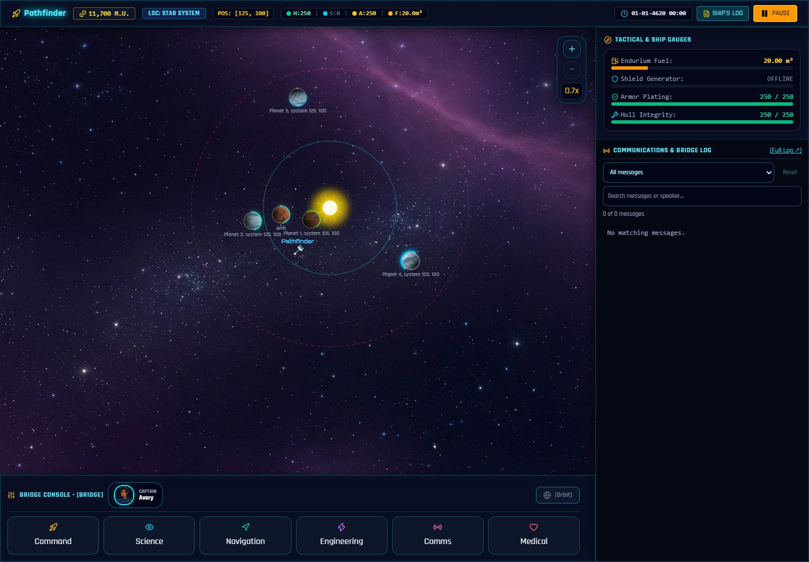
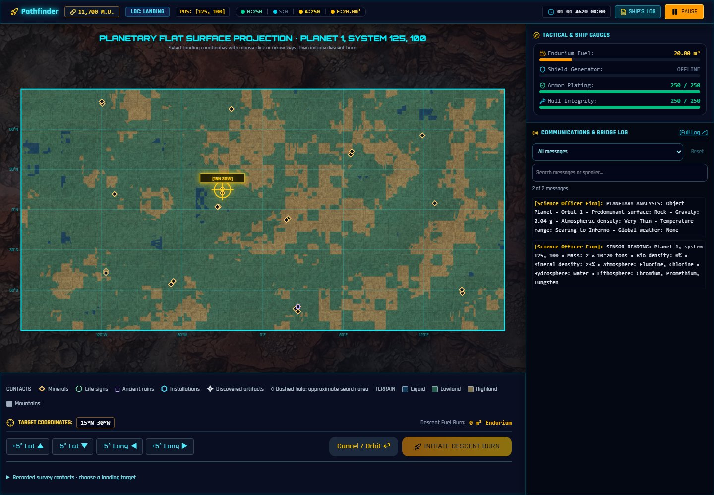

# Player Guide

A spoiler-free guide to your first expedition and the systems used throughout
the campaign. For setup, see the [README](README.md) or [Windows instructions](WINDOWS_TESTING.md).
Keep the [controls reference](docs/CONTROLS.md) nearby while learning shortcuts.

## Your job

Command an Interstel exploration vessel based at Starport Arth. Explore systems,
study worlds, earn money and investigate your discoveries. Operations bulletins
and alien conversations introduce the larger story. Useful leads are not confined
to combat or expensive equipment.

**Prepare → fly out → scan and analyze → land and explore → return with cargo
and information → refuel, sell, train and repair.**

The presentation is playful, but casualties, hazardous planets and poor financial
decisions matter. Save regularly and keep exported backups at milestones.

## First mission: prepare at Arth

Choose **START NEW MISSION** and read the briefing pages. A fresh mission starts
with **12,000 M.U., Class 1 engines and 20 m³ of Endurium**. It does not start
with an assembled crew or a named, fully upgraded ship. An empty slot is selected
first; if every slot is occupied, the game asks before replacing one.

### Read Operations

Visit **Operations** for notices, leads and evaluations. A pending evaluation
must be acknowledged before another departure. Check again after surveys and
important discoveries.

### Recruit and train

In **Personnel**, select **Create**, enter a name or use **Generate name**,
choose a species and enlist. Humans, Velox, Thrynn, Elowan and Androids have
different starting skills, limits and learning characteristics. Portraits do not
determine skills; explicit saved portrait identities stay stable.

Select an officer and choose **Train**. Check several categories to buy their
sessions together; the dialog shows the total. Each selected category costs
**300 M.U.** per session. Training respects species limits; Androids cannot be
trained. Leave money for supplies and repairs rather than spending the whole grant.

### Assign six posts

In **Crew Assignment**, fill Captain, Science Officer, Navigator, Engineer,
Communications and Doctor. Choose living officers suited to the work: Science
for interpretation, Navigation for flight, Engineering for repairs, Communications
for dialogue and Medicine for treatment. Recruitment alone does not assign a post.

The bay requires **6/6 staffed posts**. Revisit assignments after losing or
replacing an officer. Assignment voices supplement visible feedback; text remains
available if audio is muted or unavailable.

### Name and inspect the ship

In **Ship Configuration**, choose **Name**, enter a name and save it. Review
engines, cargo pods, shields, armor, lasers and missile launchers. Your Class 1
starter engines suffice for the first departure if installed and working; you
do not need to buy another engine immediately.

Higher engine classes improve propulsion and fuel use; mass and condition also
affect flight. Each cargo pod adds 50 m³ to the 50 m³ base hold. Endurium and
other cargo share capacity. Installed weapons and cargo visibly change
the ship, while shields and armor provide different protection.

Armor classes 1–5 visually cover cumulative 20%, 40%, 60%, 80% and 100% of the
armor-eligible hull skin around tactical priorities. Windows, openings and
separate hardware remain distinct. Read prices and condition in the
configuration panel rather than estimating them from the picture.

### Check supplies and depart

In **Trade Depot**, inspect Endurium and supplies. Preserve fuel for the return
and cargo room for discoveries. The **Bank** records money and transactions;
balances are in M.U.

In **Docking Bay**, inspect departure status. Launch is refused without a name,
installed engine, fuel, six living assigned posts, or acknowledgment of pending
evaluations. Follow the warning to the relevant station. Once cleared, let the
undocking sequence finish or use Enter/Space to skip it.

## Fly and navigate

Use **Navigation → Maneuver** and WASD/arrow keys for directional flight.
Relevant small-screen views also offer a steering pad. Release the direction
to stop issuing thrust. Installed class, condition, fuel and ship mass matter.

Approach a planet until **Orbit** becomes available. Establish orbit before
orbital surveys or landing. **Leave Orbit** returns to system flight. Crossing
a system's boundary returns to hyperspace; reaching a star in hyperspace enters
its system automatically.

Open the **Starmap**, use its zoom controls and read its legend. Star colors
indicate spectral classes; colored circles mark approximate alien territories.
Clouds are nebulae, cyan lines are known continuum fluxes, the cyan beacon is
your ship, a yellow ring is the target, and a red route indicates insufficient fuel.
A selected chart location is guidance, not a substitute for checking position,
fuel and destination. The + and − keys zoom the main system/hyperspace flight
views; the Starmap has separate visible zoom controls.

## Scan first, then analyze

In orbit, open **Science**, run **Scan planet**, wait for the sweep to finish,
then choose **Analyze reading**. Measurements and interpretation are distinct.

| Tab | Purpose |
| --- | --- |
| Survey map | Recorded contacts, uncertainty and landing planning |
| Readings | Mass, biological/mineral density and atmosphere, hydrosphere and lithosphere constituents |
| Analysis | Interpreted surface, gravity, atmospheric density, temperatures and weather |
| Ship status | Current hull, protection, fuel and sensors |

Science skill affects certainty, survey coverage and precision. **Not certain**
is a real limitation. Rescan before another analysis, or improve/reassign Science.
Poor or inoperative sensors can prevent a successful scan. Unknown fields are
not safe conditions just because the planet looks inviting.

Biological/mineral percentages describe relative density, not a promised deposit
at the landing point or exact percentages of each listed compound.

## Understand the maps

The legend distinguishes **minerals**, **life signs**, **ancient ruins**,
**installations** and **discovered artifacts**, plus terrain categories. Not
every world has every kind of contact.

- A dashed halo is an approximate search area, not an exact location.
- Group counts summarize findings; they are not ore grades or prices.
- Unmarked means unexplored or unreported, not necessarily empty or safe.
- Wildlife can move after observation.
- Scans do not automatically expose every hidden relic or special story encounter.

Whole-planet maps help choose a region. Landing-region and tactical maps show
local context; the tactical map also shows ship, rover and waypoint. Click a
local destination to set a rover waypoint. Manual steering overrides auto-drive.
A global contact may be outside the landing region currently displayed.

## Land and use the rover

Open the landing map, select coordinates by clicking or using the latitude/
longitude buttons, and check **descent fuel cost** and planetary conditions.
Initiate descent when ready. Gravity, weather and other hazards can make surface
work dangerous.

Choose **Disembark Rover** after landing. The ship remains your base.
Use ground zoom, the local map and distance-to-ship reading to keep your bearings.

### Mine deposits

Open **Mine [G]**, choose a deposit and inspect distance, ore, rover energy and
hold space. Use **Approach deposit** if needed. Within **6 km**, start the laser.
Approach assistance does not start extraction automatically.

The pulsing laser extracts with industrial sound effects when enabled. The
console explains conditions that stop or prevent it. **G** starts/stops mining;
the console also has start/stop controls. Moving or closing it can end extraction.

The rover holds **50 m³**. A full hold means return to offload, not necessarily
that a deposit is empty. **Return to ship** sets the return route; manual steering
overrides it. Near the ship, choose **Board Starship** or press **B/Enter**.
Transfer needs free ship capacity; read messages if something does not fit.
Allow cargo room for fuel and finds.

### Record life and investigate discoveries

Use **Scan**, **Look** and cargo actions for nearby objects. **Record lifeform**
needs an eligible unrecorded target in range and rover energy. Tracking assist
follows moving subjects; manual steering overrides it. Attacks can delay recording.

Recorded biological data and captured specimens are separate: eligible new data
earns survey rewards on return, while specimens retain their own manual sale
flow. Investigate ruins/installations when safe. Discoveries can provide
information or recoverable objects, and some need further context or equipment.
Keep notes instead of assuming every artifact should be sold immediately.

If stranded, read the available recovery option and invoice. Emergency recovery
can be expensive; plan the ordinary return route first.

## Return, trade and improve

Board, ascend, leave orbit and navigate back to Arth and its starport. Approach
until docking is available and use the docking control. A return waypoint alone
does not board or dock the ship.

At **Trade Depot**, sell intended cargo, replenish fuel and review artifact/
specimen options. Ordinary minerals normally resell for less than their purchase
price; Endurium follows its prevailing market value. Buying and immediately
reselling stock is not a substitute for exploration income.

Review Operations notices and evaluations. Eligible new lifeform data can earn
rewards on return; captured specimens still need their separate sale.
**Command → Log Planet** records telemetry or recommends a world for colonization.
Recommendations carry consequences: verify habitability rather than assuming
every recommendation earns a bonus.

Repair damage and train before the next voyage. Field repairs in **Engineering**
consume specified materials and depend on the engineer. Starport repairs charge
money. Use **Medical** for treatment. Installed, healthy and operative are
different equipment states; check all relevant feedback.

## Encounters and combat

Contact need not mean firing. In **Communications**, read attitude and responses.
Repeated hails, threats, attacks and ignored questions can have consequences.
Use the ship's log and filters to retain information rather than relying on memory.

If fighting is necessary, use **Combat** to raise installed shields, arm weapons
and select a target. Movement, range, equipment, condition and cooldowns affect
available shots. Use the weapon buttons and feedback. **Tab/T** cycles targets;
directional controls also support tactical grid movement. Keep an escape/fuel
plan and inspect damage afterward.

**Communications → Distress** offers emergency recovery in eligible situations.
Read its confirmation: towing is expensive and unavailable in some states.

## Follow the story without spoilers

Read Operations bulletins, retain alien clues and revisit leads when information
or equipment changes what you can do. Log filters separate alerts, reports and
banter. Progress survives supported saves. A successful short survey voyage is
a useful first milestone; the campaign does not require buying every upgrade
or following a spoiler walkthrough immediately.

## Pause, save and update

**P/Escape** toggles pause in normal play; a focused dialog may handle Escape
first. Use **Pause → Mission → Save Mission** for the active slot and export
backups before updates or after important discoveries. There are five slots.

Browser, address and port define the save location. Export/import when moving
between developer preview, portable tester, another browser or another computer.
Invalid/oversized imports are rejected without replacing a slot. If the game
reports session-only storage, export before closing. Preserve old backups when
a restore fails; see the [FAQ](docs/FAQ.md).

Supported existing missions can use updated portraits, scans, maps and Leave
Orbit. Rescan worlds to supplement older survey coverage; you do not need to
discard an ongoing mission.
