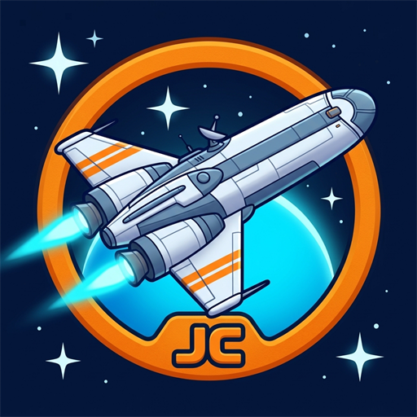
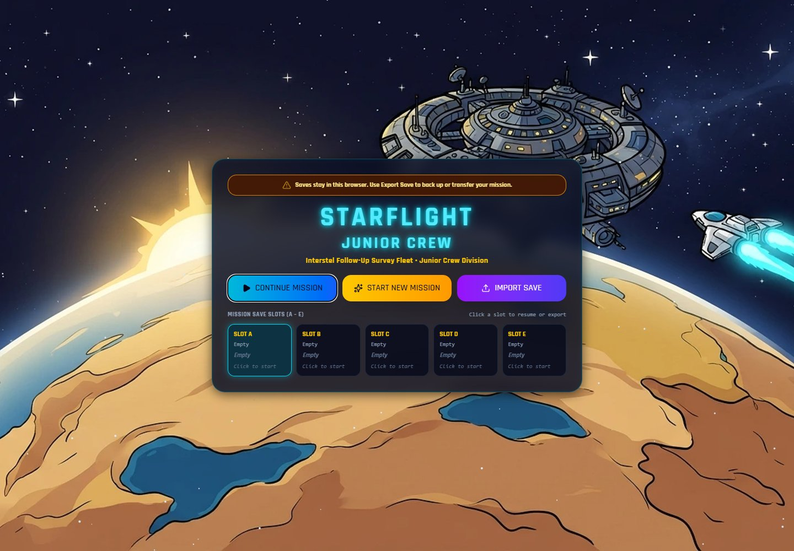
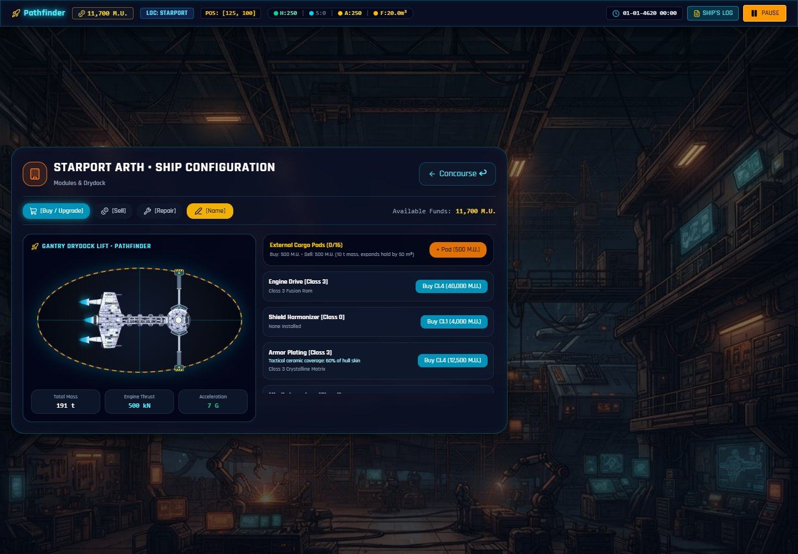
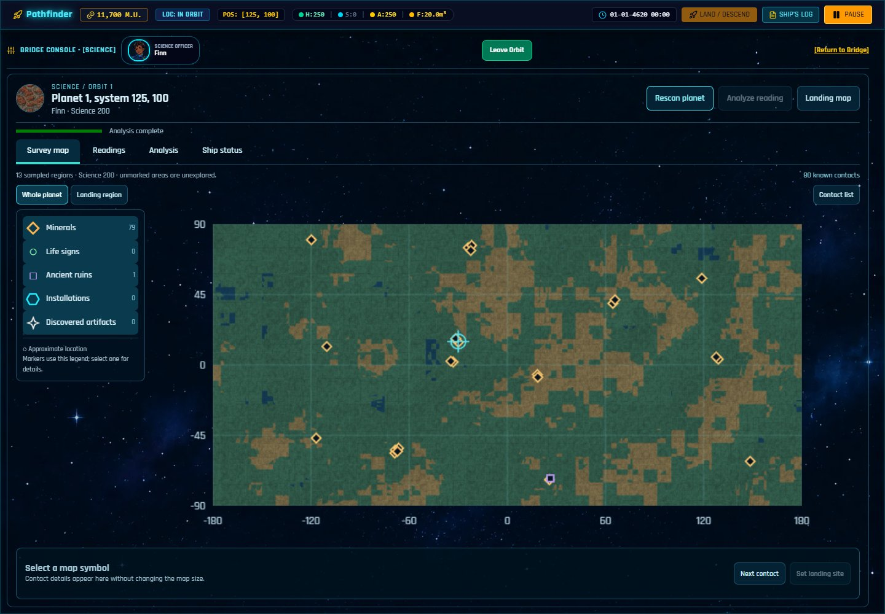
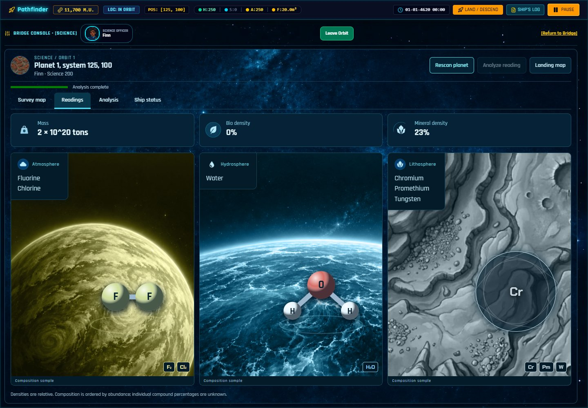
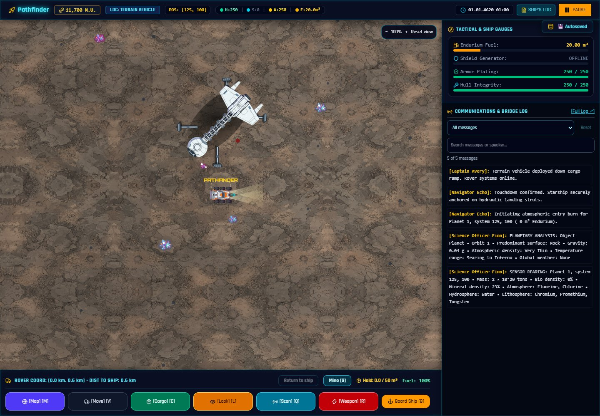

# Starflight: Junior Crew

  

**Explore strange worlds. Keep your crew alive. Bring something valuable home.**

Starflight: Junior Crew is a single-player space exploration RPG inspired by the
1986 *Starflight*. Captain a configurable ship from Starport Arth, recruit a crew,
investigate alien signals, survey planets and drive a rover across their surfaces.
Mineral sales fund equipment and training; discoveries and conversations lead
into a larger mystery threatening the stars.

Painted cartoon scenery, expressive portraits, voiced conversations and workplace
comedy give the expedition a lighter personality. Fuel, cargo space, dangerous
environments and uncertain intelligence still demand careful decisions. The remake
preserves many original rules while adding modern presentation and usability
improvements; it is not an exact emulation of the original.

**Status: source-available preview.** Public source is at
[starflight-junior-crew-public](https://github.com/cptjamestiberiouskirk-pixel/starflight-junior-crew-public).
Personal play and study are allowed under [LICENSE.md](LICENSE.md);
redistribution and commercial reuse require permission. The Windows tester ZIP
is supplied privately by the maintainer; no public binary download or hosted
game is included. See [release readiness](docs/RELEASE_READINESS.md) for remaining
package, device and independent-machine checks.

The October 26 tester includes server security hardening and verified save
continuation from the previous tester. See the [verification summary](docs/VERIFICATION_2026-10-26.md)
for its build identity, checks and remaining security/release limits. The ZIP
remains a private, locally supplied artifact; it is not hosted in this repository.

## What you can do

- **Build a crew:** recruit five species, assign six posts, train several skills
  together and use a name generator. Portraits distinguish recruits.
- **Outfit your ship:** fit engines, cargo pods, shields, tactical armor, lasers
  and missile launchers. Equipment changes appearance and capabilities.
- **Explore and investigate:** fly through systems and hyperspace, meet alien
  vessels, negotiate, fight when necessary and follow clues in the ship's log.
- **Survey before landing:** scan and analyze planetary conditions. Science
  skill affects certainty and the detail of mapped findings.
- **Work on the surface:** mine deposits with pulsing industrial lasers, record
  moving lifeforms, investigate ruins and installations, and recover discoveries.
- **Return and improve:** sell cargo, replenish fuel, repair damage, collect
  eligible survey rewards and prepare for a more ambitious voyage.

| Configure your expedition | Survey a world |
| --- | --- |
|  |  |

| Read the science | Explore the surface |
| --- | --- |
|  |  |

Screenshots show a fictional documentation mission, including trained officers
and an example upgraded loadout. They do not represent starting equipment.

## Install and run on Windows

1. Obtain the private **Windows x64 tester ZIP** from the maintainer.
2. Right-click it and choose **Extract All**; wait for extraction to finish.
3. Open the extracted **Starflight Junior Crew** folder.
4. Double-click **Launch Starflight Junior Crew.exe**.
5. Choose **START NEW MISSION**, or import an existing .sfsave backup.

Players need no Python, Node.js, Git or terminal commands. Keep the game and
runtime folders beside the launcher. The package targets Windows 10/11 on
Intel/AMD x64 PCs with Edge or Chrome. Allow about **4 GB free** to retain the
ZIP and extracted files. Detailed hardware minimums have not been certified.

The address **http://127.0.0.1:4188/starflight-junior-crew/** works on your own
computer. Use its Windows tray icon to reopen the game or stop the tester server.
The launcher is unsigned and may receive an unfamiliar-app notice; it does not
change Windows security or firewall settings.

Artwork, fonts, music and effects are local. Recorded voices need internet;
conversations remain readable when a recording cannot load. Click inside the
game once to allow browser audio.

[Full Windows installation, updating and troubleshooting](WINDOWS_TESTING.md)

## Your first voyage

1. Start a mission and read the commissioning briefing.
2. Recruit in **Personnel**; fill six posts in **Crew Assignment**.
3. Name the ship and review equipment in **Ship Configuration**.
4. Check **Operations**, fuel and the **Docking Bay** departure checklist.
5. Launch, approach a nearby planet, orbit, scan and analyze before landing.
6. Deploy the rover, gather a manageable load, board and return home.
7. Sell minerals, review new information, save and export a backup.

The first goal is a safe, profitable round trip. You do not need every upgrade
or the solution to the campaign before leaving the station.

**Read next:** [spoiler-free Player Guide](PLAYER_GUIDE.md) ·
[complete controls](docs/CONTROLS.md) · [FAQ](docs/FAQ.md)

## Saves and accessibility options

There are five mission slots, A–E. Use **Pause → Mission** to save, and
**Export Save / Import Save** for portable .sfsave backups. Saves belong to
the browser and address: changing browser or port creates a separate save
location. Supported existing saves work with the updated game; a new mission
is not required. Export a backup before updates or clearing browser data.

Settings include graphics quality, CRT, screen shake, music, effects, voices
and crew banter. Mouse and keyboard controls are available; smaller screens
also offer relevant touch controls. Physical touch-device and screen-reader
coverage remains limited.

## Build from source

Developers with Node.js 24 can clone the public source repository, open its folder
and run:

~~~sh
npm ci
npm run dev
~~~

Open **http://127.0.0.1:5173/**. Source setup is optional for players with the ZIP.
See [development instructions](docs/DEVELOPMENT.md) for cloning, validation,
production preview, packaging and deployment details.

## Feedback, credits and release information

Use the public repository's Issues page for nonsensitive bug reports with your
build ID, Windows/browser version, reproduction steps and a relevant screenshot.
Send private details to the maintainer through an agreed private channel.
Share a backup only deliberately: the game does not upload
bug reports or saves automatically. See the [reporting template](docs/FAQ.md#how-do-i-report-a-problem).

- [Credits and asset provenance](CREDITS.md)
- [Project licensing status](LICENSE.md) and [third-party notices](THIRD_PARTY_NOTICES.md)
- [Build/test status](SOURCE_SYNC.md) and [release-readiness checklist](docs/RELEASE_READINESS.md)

This is an independent fan project. References to *Starflight*, *Star Trek*,
*Star Wars* and *The Expanse* do not imply sponsorship or endorsement. A credit
or reference is not a grant of rights to third-party material.
