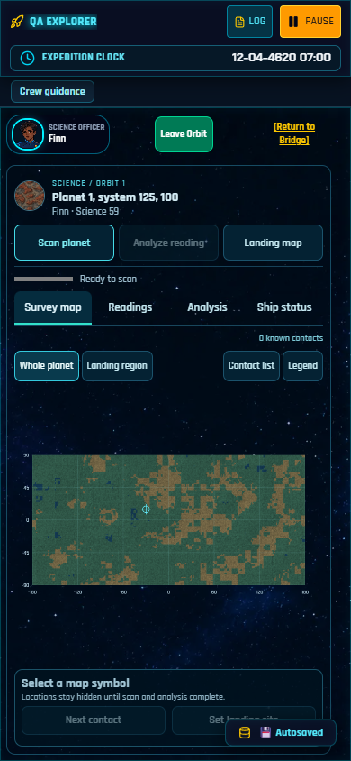

# Source update verification — October 29, 2026

The current source adds the [presentation improvements](GAMEPLAY_POLISH.md) and a
clearly labeled **Expedition clock**. It reuses the existing saved stardate/hour;
there is no new time counter, calendar, simulation rate or save migration.

The clock stays in the main HUD, receives its own row on narrow screens, and
remains visible in compact Science. Live alien transmissions show the same
readout. Small-screen autosave notifications no longer cover its date.

## Local checks

| Check | Result |
| --- | --- |
| TypeScript | Passed |
| Regression suites | 10,801 assertions, 35 suites, zero failures |
| Dependency mitigation | 68 checks passed; both guarded copies verified |
| Source-size maintenance | 161 files checked; no source exceeded the existing limit |
| Tester-server limits | 14 checks passed |
| Ship-image build cache | Six fallback, selection, completeness, corruption, stale-cache and path checks passed |
| Production build/resources | Passed; original images, ship masters, runtime images, portraits, media, fonts and notices verified |
| Clock/browser checks | 16 compiled-game cases passed |
| Native save checks | 87 cases passed, including five historical mission fixtures loaded, saved and reloaded |
| Preservation | 3,876 protected files unchanged; original time-simulation block unchanged |

Clock layout checks covered compact Science at 320×568, 390×844, 760×560,
1024×720, 1440×900 and 2560×1080. Main-screen checks also covered Starport,
Docking Bay, Star System, Hyperspace, Landing, On Planet and Terrain Vehicle.
The label and date were checked for viewport bounds, clipping and occlusion.
Live transmissions were checked separately. The existing stopped-Starport rule,
flight-hour/calendar rollover and saved-date restoration passed. A fictional
completed-campaign fixture allowed the late-year rollover test without changing
the original campaign hazard rules.

All browser checks used physically muted, disposable profiles and fictional
fixtures. Owner saves and production audio settings were preserved. No paid media
generation or new cloud security scan was performed.

## Build identity

- JavaScript: `assets/index-DKzV7Laz.js`
- SHA-256: `b2c06a652b1afe7f61226edea345fa68d4f58dc4b4ea0754ced8846b707b98a8`
- Stylesheet: `assets/index-DhSBZAb1.css`
- SHA-256: `362d0dee2d662eef8c1acbfec9eb542513230125700d2f2b22ab18456fade1b5`

The optimized ship-image build is 1,005,389,624 bytes, 35.16% smaller than the
original library. All 3,672 configurations passed exact decoded RGBA comparison.
Original PNG masters remain unchanged; see [Development](DEVELOPMENT.md) to build
the smaller distribution. Derivatives are a local build cache, not a second
committed copy of the master library.

## Scope

This is a source/documentation update. The existing private Windows tester still
has its [October 26 build identity and acceptance scope](VERIFICATION_2026-10-26.md).
No new ZIP, public binary release or hosted game is supplied by this update.
Independent Windows/device/audio acceptance and a new packaged campaign/soak
remain separate work. The existing large JavaScript chunk warning and documented
upstream security limitations remain visible.
